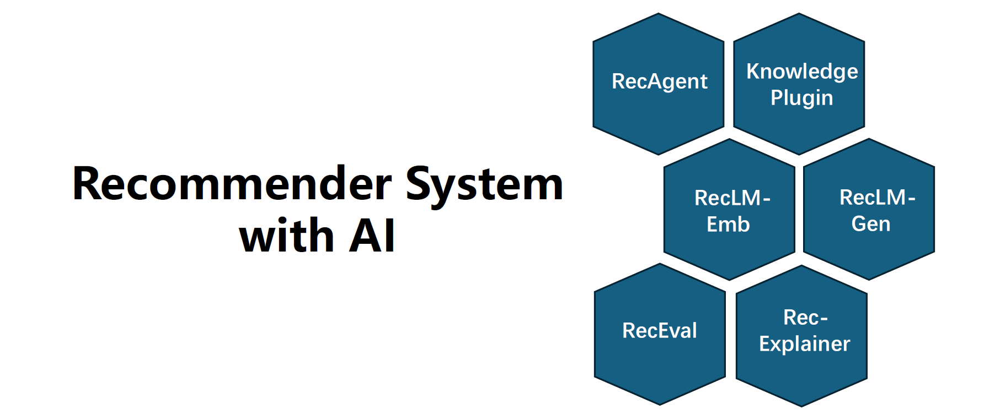

<div align="center">



# RecAI: Leveraging Large Language Models for Next-Generation Recommender Systems

</div>

Large Language Models (LLMs) offer significant potential for the development of cutting-edge recommender systems, particularly in terms of enhancing interactivity, explainability, and controllability. These are aspects that have traditionally posed challenges. However, the direct application of a general-purpose LLM for recommendation purposes is not viable due to the absence of specific domain knowledge.

The **RecAI** project aims to bridge this gap by investigating various strategies to integrate LLMs into recommender systems, a concept usually termed as **LLM4Rec**.

---

## 📁 Repository Structure & Modules

The repository folders are organized into a sequential pipeline representing each core pillar of LLM4Rec:

| Folder | Module | Original Paper / Project | Description |
| :--- | :--- | :--- | :--- |
| [01_Interactive_Agent](./01_Interactive_Agent) | **Interactive Agent** | InteRecAgent | Conversational AI agent using LLMs as the brain and traditional recommender models (SQL, similarity, ranking) as tools. |
| [02_Knowledge_Plugin](./02_Knowledge_Plugin) | **Selective Knowledge Plugin** | DOKE / Knowledge Plugin | Injects domain-specific collaborative filtering patterns (I2I / U2I) into LLM prompts without fine-tuning. |
| [03_Retrieval_Embedding](./03_Retrieval_Embedding) | **Retrieval Embedding** | RecLM-emb | Optimizes text embedding models across 10 distinct task formulations for dense item retrieval. |
| [04_Generative_Recommender](./04_Generative_Recommender) | **Generative Recommender** | RecLM-gen | Fine-tunes generative LLMs via Supervised Fine-Tuning (SFT) and Reinforcement Learning (RL) for item ranking and user simulation. |
| [05_Unified_Recommender](./05_Unified_Recommender) | **Unified Constrained Rec** | RecLM-uni | Native LLM generative recommendation using control tokens, prefix-tree constrained decoding, and GRPO to eliminate hallucinations. |
| [06_Model_Explainer](./06_Model_Explainer) | **Model Explainer** | RecExplainer | Uses LLMs as surrogate models aligned in behavior, latent intention, and hybrid spaces to explain black-box recommendation models. |
| [07_Evaluation_Suite](./07_Evaluation_Suite) | **Evaluation Suite** | RecLM-eval | Comprehensive evaluation benchmark assessing LLM recommenders on retrieval, ranking, explanation, and multi-turn conversation. |
| [assets](./assets) | **Assets** | - | Architectural diagrams, framework figures, and visual assets. |

---

## 🚀 Quick Navigation

* **Conversational Rec**: Explore [01_Interactive_Agent/README.md](./01_Interactive_Agent/README.md) to launch the interactive Gradio agent demo.
* **Prompt Enhancement**: Check [02_Knowledge_Plugin/README.md](./02_Knowledge_Plugin/README.md) for domain collaborative filtering prompt injection.
* **Dense Retrieval**: See [03_Retrieval_Embedding/README.md](./03_Retrieval_Embedding/README.md) for item embedding training and evaluation.
* **Fine-Tuning Generative LLMs**: Review [04_Generative_Recommender/README.md](./04_Generative_Recommender/README.md) and [05_Unified_Recommender/README.md](./05_Unified_Recommender/README.md).
* **Interpretability**: See [06_Model_Explainer/README.md](./06_Model_Explainer/README.md) for surrogate model alignment.
* **Benchmarking**: Run [07_Evaluation_Suite/README.md](./07_Evaluation_Suite/README.md) to evaluate your models.

---

## 📜 Citations

If this repository assists your research or implementation, please cite the corresponding works:

```bibtex
@inproceedings{10.1145/3589335.3651242,
    author = {Lian, Jianxun and Lei, Yuxuan and Huang, Xu and Yao, Jing and Xu, Wei and Xie, Xing},
    title = {RecAI: Leveraging Large Language Models for Next-Generation Recommender Systems},
    year = {2024},
    booktitle = {Companion Proceedings of the ACM Web Conference 2024},
    pages = {1031–1034}
}
```
*(Detailed paper citations for each sub-module can be found within their respective directory README files).*
